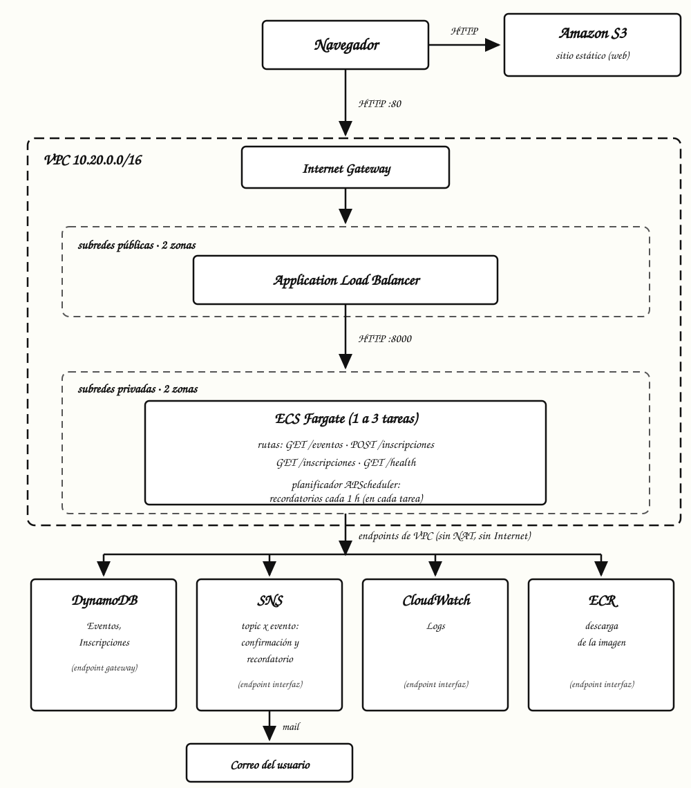
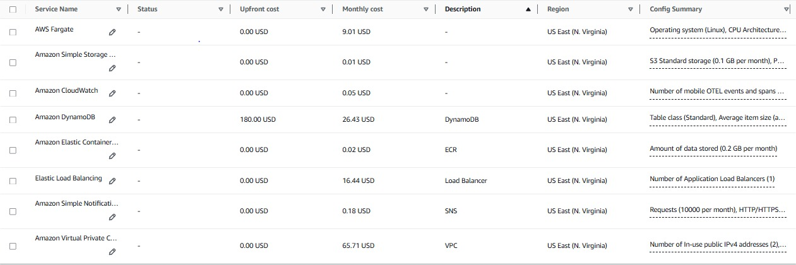

# Informe del proyecto sobre el sistema de inscripción y recordatorios para eventos

**Integrantes del equipo:** Augusto Calastretti, Augusto Cambon, Bruno Carballido.

**Repositorio:** https://github.com/Bruno-Carballido/aws-eventos-um

Este informe describe la arquitectura, la seguridad, la escalabilidad, la resiliencia, los costos y los permisos de IAM del sistema. El backend corre en contenedores con Amazon ECS y AWS Fargate, detrás de un Application Load Balancer (ALB), dentro de una VPC propia con subredes privadas y endpoints de VPC. Todo lo que se describe como verificado se desplegó y probó en AWS Academy, en la región us-east-1.

## 1. Arquitectura

### 1.1 Componentes

| Componente | Servicio | Función |
|---|---|---|
| Sitio web | Amazon S3 (website endpoint) | Entrega el frontend compilado con React y Vite. |
| Balanceador | Application Load Balancer (ALB), subredes públicas | Recibe tráfico HTTP en el puerto 80, lo reenvía a las tareas en el puerto 8000 y verifica su estado en `/health`. |
| Backend | Amazon ECS con AWS Fargate, subredes privadas | Ejecuta la API en Python 3.12 con FastAPI y Uvicorn (`GET /eventos`, `POST /inscripciones`, `GET /inscripciones`). Corre de 1 a 3 tareas. |
| Planificador | APScheduler (`AsyncIOScheduler`) dentro de cada tarea | Envía los recordatorios cada hora, con un reclamo condicional por evento. |
| Base de datos | Amazon DynamoDB | Tablas `Eventos` e `Inscripciones` (índices `porEvento` y `porEmail`) en modo bajo demanda, con cifrado en reposo. |
| Notificaciones | Amazon SNS | Envía correos de confirmación y recordatorios con un topic por evento. |
| Registro de imágenes | Amazon ECR (`aws-eventos-um-backend`) | Almacena la imagen Docker del backend, de unos 187 MB. |
| Red | Amazon VPC (`vpc-aws-eventos-um`, 10.20.0.0/16) | Subredes públicas para el ALB, subredes privadas para las tareas y endpoints de VPC. No hay NAT. |
| Registros | Amazon CloudWatch Logs | Grupo `/ecs/aws-eventos-um-backend`, con retención de 7 días. |

La versión anterior del proyecto usaba Lambda, API Gateway, una regla de EventBridge y una cola SQS DLQ. Se reemplazaron por ECS Fargate, el ALB y el planificador dentro de cada tarea.

### 1.2 Flujo de tráfico



1. El usuario abre el sitio web en S3.
2. La página envía las solicitudes al DNS del ALB en el puerto 80.
3. El ALB reenvía las peticiones al puerto 8000 de una tarea sana, ubicada en una de las subredes privadas:
   - `GET /eventos` lee la tabla `Eventos` y devuelve el catálogo ordenado por fecha con los cupos disponibles.
   - `POST /inscripciones` valida que no haya una inscripción previa, incrementa el contador de cupo de forma atómica (`inscritos < cupo`), guarda la inscripción en DynamoDB y publica la confirmación en SNS.
   - `GET /inscripciones?email=` consulta el índice `porEmail` de la tabla `Inscripciones` y devuelve el historial del usuario.
4. Cada hora, el planificador de cada tarea busca los eventos de las próximas 24 horas. Antes de publicar un recordatorio, reclama el evento con una escritura condicional sobre el campo `notificado` en DynamoDB, de modo que solo una tarea lo envía.
5. Las tareas envían sus registros a CloudWatch Logs.

### 1.3 Decisiones de diseño

- Fargate evita mantener máquinas virtuales EC2 y aplicar parches al sistema operativo. El costo es fijo por tarea mientras esté encendida.
- El planificador corre dentro de cada tarea con APScheduler. No necesita un disparador externo, y AWS Academy no permite crear los roles que ese disparador necesitaría. El reclamo condicional por evento evita envíos duplicados entre tareas.
- Las tareas están en subredes privadas sin ruta a Internet y sin NAT. Hablan con los servicios de AWS por endpoints de VPC. Los de tipo Gateway son para S3 y DynamoDB, y los de tipo interfaz para ECR API, ECR Docker, CloudWatch Logs y SNS, con DNS privado en ambas subredes. Un NAT Gateway cobraría por hora sin aportar nada hoy. Si una tarea necesitara salir a Internet, se agregaría entonces.
- El control de cupos está en DynamoDB. La condición `attribute_not_exists(inscritos) OR inscritos < :cupo` previene la sobreventa a nivel de base de datos, también cuando varias tareas reciben inscripciones al mismo tiempo.

## 2. Seguridad

### 2.1 Canales de comunicación

| Canal | Protocolo | Exposición | Control |
|---|---|---|---|
| Usuario a S3 | HTTP | Pública | Política de bucket de solo lectura pública. |
| Usuario a ALB | HTTP (puerto 80) | Pública | Grupo de seguridad del ALB con entrada TCP 80 desde 0.0.0.0/0. |
| ALB a tareas ECS | HTTP (puerto 8000) | Privada | Grupo de seguridad de las tareas con entrada TCP 8000 solo desde el grupo del ALB. |
| Tareas ECS a DynamoDB, SNS, ECR y CloudWatch Logs | HTTPS (puerto 443) | Privada | Endpoints de VPC en las subredes privadas. Sin NAT y sin salida a Internet. |
| SNS a correo del usuario | SMTP con TLS | Pública | Confirmación de suscripción previa por parte del usuario. |

### 2.2 Grupos de seguridad

- El grupo del ALB acepta TCP 80 desde 0.0.0.0/0 y solo puede enviar tráfico a 10.20.0.0/16 en el puerto 8000.
- El grupo de las tareas acepta TCP 8000 únicamente desde el grupo del ALB. Su salida es TCP 443 hacia 10.20.0.0/16 y hacia 0.0.0.0/0. La salida a Internet no tiene ruta, así que en la práctica no sale nada.
- El grupo de los endpoints acepta TCP 443 desde 10.20.0.0/16.

Las tareas no tienen IP pública. Una petición directa a una tarea no llega, porque no hay ruta desde Internet y el grupo solo acepta tráfico del ALB.

### 2.3 Protocolos, cifrado e identidad

- DynamoDB cifra los datos en reposo con claves administradas por AWS.
- Las llamadas del contenedor a DynamoDB, SNS, ECR y CloudWatch Logs usan HTTPS y viajan por los endpoints de VPC dentro de la red de AWS.
- La aplicación no guarda credenciales en código ni en variables de entorno. Las credenciales temporales provienen del rol asignado a la tarea.

### 2.4 Debilidades conocidas

- La API no tiene autenticación. `GET /inscripciones?email=` responde a quien conozca el correo.
- El sitio, el ALB y el tráfico entre el ALB y las tareas usan HTTP. No hay HTTPS. CloudFront está denegado en Academy, y el HTTPS del ALB requiere un certificado de ACM que no se probó.
- No hay WAF ni límite de tasa por ruta.
- El contenedor corre como root. La mejora pendiente es un usuario sin privilegios.
- El rol LabRole es compartido y tiene permisos amplios. En producción se separa por función (sección 6).

## 3. Escalabilidad

### 3.1 Configuración

- El servicio ECS arranca con 1 tarea.
- Application Auto Scaling define un mínimo de 1 tarea y un máximo de 3.
- La política de seguimiento de objetivo usa el CPU promedio del servicio, con un objetivo de 60 %.
- El escalado hacia arriba tiene un cooldown de 60 segundos, y hacia abajo de 300 segundos.
- Cada tarea usa 0.25 vCPU y 0.5 GB de memoria.
- Application Auto Scaling usa el rol vinculado al servicio `AWSServiceRoleForApplicationAutoScaling_ECSService`. El parámetro LabRole aparece en la plantilla, pero el escalado no lo usa.

### 3.2 Por qué escala solo con carga sostenida

La política de seguimiento de objetivo compara el CPU promedio del servicio contra el 60 %. Un pico corto no alcanza para disparar una acción de escalado, porque la política necesita ver la métrica por encima del objetivo durante varios puntos de medición. Por eso la capacidad sube cuando la carga se mantiene y baja más lento, con un cooldown de 300 segundos, para evitar oscilaciones. Este es el comportamiento estándar de la política de AWS.

### 3.3 Prueba de escalado

Con 60 conexiones paralelas, el CPU llegó a entre 75 y 83 % durante tres minutos. La capacidad pasó de 1 a 2 tareas y luego a 3. Las tres quedaron `healthy` repartidas en las dos subredes privadas (10.20.10.x y 10.20.11.x).

Queda sin configurar el escalado por peticiones por segundo del ALB.

## 4. Resiliencia y fallas

### 4.1 Distribución en dos zonas

- El ALB está en dos zonas, con las subredes públicas 10.20.0.0/24 (zona a) y 10.20.1.0/24 (zona b).
- Las tareas están en dos subredes privadas, 10.20.10.0/24 (zona a) y 10.20.11.0/24 (zona b). En la prueba se verificaron tareas en 10.20.10.x y en 10.20.11.x.
- DynamoDB replica los datos en tres zonas de la región, según la documentación de Amazon DynamoDB.
- SNS es un servicio administrado por AWS. Su disponibilidad por zona no se probó en esta entrega.

### 4.2 Comportamiento ante fallas

| Falla | Efecto en el usuario | Efecto en los datos | Recuperación |
|---|---|---|---|
| Caída de una tarea o del contenedor | Con dos o más tareas, el ALB envía el tráfico a las que siguen sanas. Con una sola tarea, el servicio no responde hasta que ECS reprograma una tarea nueva. | Ninguno. | ECS reprograma las tareas que fallan para mantener la cantidad deseada. Es el comportamiento documentado de ECS. |
| Falla de una zona de disponibilidad | Con dos o más tareas repartidas en dos zonas, el ALB sigue atendiendo desde la zona sana. Con una sola tarea, hay interrupción hasta que ECS la reprograma en la zona sana. | Ninguno. DynamoDB replica los datos en tres zonas. | Igual que la fila anterior. Pendiente de probar con una falla provocada. |
| Evento sin lugares disponibles | La API responde 409. | La base de datos no cambia. | Comportamiento esperado por regla de negocio. |
| Error en el envío de un recordatorio | Ese recordatorio no sale en esa hora. | Si la publicación falla, la marca se libera. Si la tarea falla entre el reclamo y la publicación, el recordatorio puede quedar sin enviar. | La siguiente ejecución horaria lo reintenta cuando la marca se liberó. |

### 4.3 Decisión de mínimo de 1 tarea

El servicio usa un mínimo de 1 tarea para reducir el costo, porque cada tarea encendida cobra por hora. La consecuencia es que la falla de esa tarea, o de la zona donde está, deja el servicio sin respuesta hasta que ECS la reprograma. La alternativa es un mínimo de 2 tareas repartidas en dos zonas, que cubre la falla de una zona sin interrupción a cambio de un costo mayor por hora.

### 4.4 Verificaciones realizadas

- Las pruebas unitarias pasan 29 de 29. Usan boto3 con `Stubber` para validar los parámetros contra el modelo de DynamoDB.
- `cfn-lint` no reporta errores, y `aws cloudformation validate-template` pasa en la cuenta de Academy.
- En el contenedor local, `/health` responde 200 e `/inscripciones` sin email responde 400.
- Stack `aws-eventos-um` en `CREATE_COMPLETE`. Una tarea en 10.20.10.30 con destino del ALB `healthy`.
- Por el ALB, la API responde `/health` 200, `/eventos` 200, inscripción 201, duplicado 409, consulta por email 200 y email inválido 400.
- En concurrencia, 12 inscripciones simultáneas a un evento de cupo 10 dieron 10 respuestas 201 y 2 respuestas 409. El contador final es 10.
- En los recordatorios, dos ejecuciones simultáneas sobre el mismo evento, como si fueran dos tareas, Una envió y la otra no envió nada. El campo `notificado` quedó escrito en DynamoDB, y una ejecución posterior no envió nada.
- El escalado se describe en la sección 3.3.
- Se encontró y corrigió un defecto. Los eventos sin atributo `inscritos` devolvían la respuesta sin ese campo, y la tarjeta del sitio mostraba «undefined/30 lugares». Se corrigió en `listar_eventos` (inscritos por defecto 0), con prueba, y se reconstruyó y desplegó la imagen.

## 5. Costos

### 5.1 Componentes que cobran por hora

Mientras el stack existe, cobran por hora:

- La tarea Fargate mínima encendida todo el tiempo (0.25 vCPU y 0.5 GB), más las tareas adicionales que enciende el escalado.
- El ALB, encendido todo el tiempo.
- Los cuatro endpoints de VPC de tipo interfaz (ECR API, ECR Docker, CloudWatch Logs y SNS), en dos zonas.

### 5.2 Componentes por uso



### 5.3 Estimación mensual pendiente

El monto mensual aproximado es USD117,85. Se calcula con la calculadora de precios de AWS, cargando las tareas, el ALB, los cuatro endpoints en dos zonas y el uso previsto de DynamoDB, ECR, S3 y CloudWatch. 

### 5.4 Desmontaje después de las pruebas

Por instrucción del estudiante, se deshacen todos los cambios para no tener gastos sorpresa. El stack se elimina al terminar las pruebas. Antes hay que vaciar el bucket del sitio y borrar los topics SNS que creó la aplicación, porque no forman parte del stack. Los pasos están en el README, sección 4.

## 6. Roles y permisos de IAM

### 6.1 Uso de LabRole en AWS Academy

- Los permisos de IAM no permiten crear roles ni políticas propias (`iam:CreateRole` denegado).
- La cuenta incluye un rol preexistente llamado `LabRole` (`arn:aws:iam::<cuenta>:role/LabRole`) con permisos amplios para los servicios del laboratorio.
- LabRole cumple dos papeles, como rol de ejecución (`ExecutionRoleArn`) y como rol de tarea (`TaskRoleArn`).
- CloudFront está denegado en Academy.
- Academy tampoco permite crear los roles que requeriría un disparador externo del planificador. Por eso el planificador queda dentro de la tarea (sección 1.3).

### 6.2 Servicios que necesitan permisos

| Servicio | Qué necesita | Lo que permite Academy | Rol en producción |
|---|---|---|---|
| ECS, descarga de la imagen | Leer la imagen desde ECR | LabRole como rol de ejecución | `ecsTaskExecutionRole` |
| ECS, registros | Escribir en CloudWatch Logs | LabRole como rol de ejecución | `ecsTaskExecutionRole` |
| API y planificador | Leer y escribir en DynamoDB, publicar en SNS | LabRole como rol de tarea | `backendEventosTaskRole` |
| Application Auto Scaling | Leer métricas y cambiar la cantidad de tareas | Rol vinculado al servicio `AWSServiceRoleForApplicationAutoScaling_ECSService` | Sin cambios |
| S3 (sitio web) | Lectura pública del bucket | Política de bucket de solo lectura pública | `cloudfrontOACPolicy`, si se agrega CloudFront |
| Disparador externo del planificador | No aplica | No se pueden crear roles para un disparador externo | No aplica, porque el planificador queda dentro de la tarea |

### 6.3 Roles de mínimo privilegio en producción

En un entorno fuera de AWS Academy, el principio de mínimo privilegio exige separar estos permisos en roles independientes.

#### 1. Rol de ejecución de ECS (`ecsTaskExecutionRole`)

Confía en `ecs-tasks.amazonaws.com`. Permite al agente de ECS descargar la imagen y configurar los registros antes de iniciar la aplicación. Este rol no debe tener acceso a DynamoDB, SNS ni datos de negocio.

```json
{
  "Version": "2012-10-17",
  "Statement": [
    {
      "Effect": "Allow",
      "Action": [
        "ecr:GetAuthorizationToken",
        "ecr:BatchCheckLayerAvailability",
        "ecr:GetDownloadUrlForLayer",
        "ecr:BatchGetImage"
      ],
      "Resource": "*"
    },
    {
      "Effect": "Allow",
      "Action": [
        "logs:CreateLogStream",
        "logs:PutLogEvents"
      ],
      "Resource": "arn:aws:logs:*:*:log-group:/ecs/aws-eventos-um-backend:*"
    }
  ]
}
```

#### 2. Rol de la tarea de ECS (`backendEventosTaskRole`)

Confía en `ecs-tasks.amazonaws.com`. Son las credenciales que usa la aplicación dentro del contenedor para operar con AWS. Este rol solo accede a las tablas y a los topics del proyecto. No tiene permisos sobre ECR ni sobre la administración de ECS.

```json
{
  "Version": "2012-10-17",
  "Statement": [
    {
      "Sid": "DynamoDBEventos",
      "Effect": "Allow",
      "Action": [
        "dynamodb:Scan",
        "dynamodb:GetItem",
        "dynamodb:UpdateItem"
      ],
      "Resource": "arn:aws:dynamodb:*:*:table/Eventos"
    },
    {
      "Sid": "DynamoDBInscripciones",
      "Effect": "Allow",
      "Action": [
        "dynamodb:PutItem",
        "dynamodb:Query"
      ],
      "Resource": [
        "arn:aws:dynamodb:*:*:table/Inscripciones",
        "arn:aws:dynamodb:*:*:table/Inscripciones/index/*"
      ]
    },
    {
      "Sid": "SNSEventos",
      "Effect": "Allow",
      "Action": [
        "sns:CreateTopic",
        "sns:Subscribe",
        "sns:Publish",
        "sns:ListTopics"
      ],
      "Resource": "arn:aws:sns:*:*:evento-*"
    }
  ]
}
```

### 6.4 Comparación de roles

| Componente | Rol en AWS Academy | Rol en producción | Permisos requeridos |
|---|---|---|---|
| Agente de ECS (descarga y logs) | `LabRole` | `ecsTaskExecutionRole` | Lectura de ECR y escritura de logs en CloudWatch. |
| API en FastAPI | `LabRole` | `backendEventosTaskRole` | Operaciones sobre `Eventos`, `Inscripciones` y SNS. |
| Planificador interno | `LabRole` | `backendEventosTaskRole` | Lectura y actualización en `Eventos`, publicación en SNS. |
| Sitio web en S3 | Sin rol (público) | `cloudfrontOACPolicy` | Acceso al bucket restringido a la distribución de CloudFront. |

## 7. Limitaciones

- Las debilidades de seguridad (autenticación, HTTP, WAF, root en el contenedor y LabRole compartido) están en la sección 2.4.
- El servicio tiene un mínimo de 1 tarea por decisión de costo (sección 4.3).
- Una sola región (us-east-1).
- DynamoDB no tiene respaldos automáticos, porque point-in-time recovery no está activado.
- Si la tarea falla entre el reclamo de un recordatorio y su publicación, ese recordatorio puede no salir.
